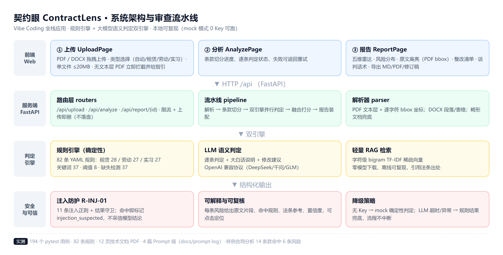
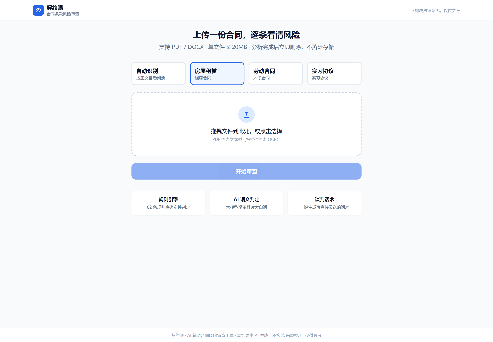
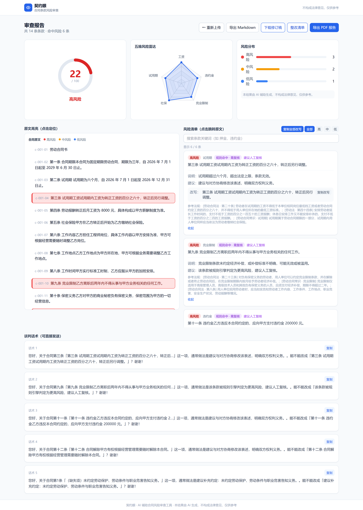

# 契约眼 ContractLens · 作品介绍文档

> 参赛赛道：AI 创新应用挑战赛（个人赛 · Vibe Coding）
> 作品形态：本地可运行的 Web 应用（FastAPI + React），零 Key 亦可完整演示
> 仓库：https://github.com/G-1112/contractlens （Public，39 次细粒度提交）
> 技术文档：`docs/技术文档.pdf`（12 页，≤30 页上限）

---

## 1. 项目详情及使用方式

### 1.1 要解决的真实问题

毕业生第一次独立签租房合同、第一次签劳动合同、第一次签实习协议，面对的是同一个问题：
**看不懂条款，更不知道该改哪一句**。律师咨询一次几百元，网上的"合同模板"没有针对他手里这一份；
通用聊天机器人给的答复无法定位到原文第几条，也无法直接拿去和房东/HR 谈判。

契约眼把这件事做成一条**文档处理流水线**，而不是一个聊天框：

```
上传合同 → 解析与条款切分 → 规则 + LLM 双引擎逐条判定 → 可视化报告 → 可交付的修订稿与谈判话术
```

### 1.2 目标用户与使用场景

| 用户 | 场景 | 输出 |
|---|---|---|
| 应届毕业生 | 签三方/劳动合同前自查 | 风险条款清单 + 修改建议 + 发给 HR 的话术 |
| 租房学生 | 签房屋租赁合同前自查 | 押金/违约金/维修责任条款的风险定位 |
| 实习生 | 签实习协议前自查 | 实习报酬、安全保险、转正条款提示 |

### 1.3 核心功能

1. **三类合同支持**：房屋租赁合同 / 劳动合同 / 实习协议；也可选择「自动识别」，按正文特征词加权分类，结果通过 SSE 事件显式回传前端，不静默兜底。
2. **逐条风险判定**：每条条款给出风险等级（高/中/低）、命中依据、通俗解释、修改建议。
3. **原文高亮联动**：点击风险卡片可定位到原文对应条款；PDF 场景按字符级 bbox 坐标在原文画布上高亮。
4. **五维雷达与评分**：从五个维度汇总风险分布，给出 0–100 分与等级。
5. **谈判话术生成**：按风险条款一键生成可以直接复制发给对方的措辞。
6. **报告导出**：Markdown / PDF / DOCX 三种格式，含整改清单与修订稿。

### 1.4 使用方式（10 分钟复现，评委可直接照做）

```bash
# 1) 后端依赖（uv.lock 已随仓库提交，版本可精确复现）
uv sync --extra dev
source .venv/bin/activate        # Windows: .venv\Scripts\activate

# 2) 启动后端（不填 LLM_API_KEY 自动进入 mock 模式，流程照常跑通）
uvicorn api.main:app --reload --port 8000

# 3) 启动前端
cd web && npm install && npm run dev     # 打开 http://localhost:5173

# 4) 验证
pytest -q                                 # 预期 194 passed
```

操作路径：选择合同类型 → 上传 `data/samples/劳动合同样本.docx` → 观察流式进度 → 查看风险卡片 →
点击卡片定位原文 → 生成谈判话术 → 导出报告。

---

## 2. 项目的亮点

### 2.1 双引擎融合：给 AI 的黑盒结论加上确定性下限

纯 LLM 方案的问题是：同一份合同两次分析结论可能不同，且没有任何可追责的依据。
契约眼把 82 条**确定性规则**与 LLM 语义判定融合，融合策略是显式的：

```
规则命中 && LLM 等级 ≥ 规则等级 → 取 LLM（来源 both）
规则命中 && LLM 等级 < 规则等级 → 取规则（来源 rule_override，标记"需复核"）
规则命中 && LLM 判定缺失       → 取规则（来源 rule_only）
无规则命中                     → 取 LLM（来源 llm_only）
```

规则命中即抬高等级下限——**即便模型判低分，命中高风险规则也不能被压低**。前端用不同标签区分
「规则命中」与「AI 判断」，不把模型输出伪装成权威结论。

### 2.2 零 Key 可复现：可复现性不是口号，是设计约束

未配置 `LLM_API_KEY` 时系统进入 mock 模式：规则引擎照常工作，LLM 判定降级为确定性启发式，
端到端演示、全部测试、验收探针均可跑通。评审在没有 API Key 的机器上也能完整复现——
这把「过程可复现性（25%）」从文档承诺变成了工程保证。

### 2.3 原文级定位：报告不是"看起来专业"，而是能落到第几条

PDF 解析时保留逐字符 bbox 坐标，报告页在前端用 pdf.js 画布还原页面并绘制高亮框；
DOCX 场景退化为条款锚点定位。风险卡片与原文双向联动，评审可以验证每一条结论的出处。

### 2.4 安全设计进入主链路（R-INJ-01）

合同文本是不可信输入，天然存在提示词注入面。系统在解析后、送模型前做注入扫描
（11 条正则），并在模型返回后做结果守卫；命中即标记 `injection_suspected`，
**不采信模型给出的结论**，改用规则结果并在报告中标红提示。注入防护不是附录里的说明，
是流水线里的一个环节，且有对应测试用例。

### 2.5 产品闭环而非功能堆砌

上传→分析→报告→话术→导出修订稿，五步都在同一个界面内完成；分析完成即删除上传文件，
不落盘、不建账号、不收集数据，界面上常驻「不构成法律意见」声明。

---

## 3. AI 技术落地使用情况概述

本项目本身就是 Vibe Coding 的产物：**代码由 AI 生成，人负责意图、约束与验收**。
AI 在项目里扮演两个角色，两者都被显式设计过。

### 3.1 角色一：被约束的被测对象（LLM 作为判定引擎）

| 环节 | 做法 | 约束手段 |
|---|---|---|
| 条款语义判定 | 逐条送模型，要求返回结构化 JSON（等级/理由/建议） | Pydantic 校验 + 枚举白名单，非法输出直接丢弃并降级 |
| 法条引用 | 轻量 RAG 检索法规片段拼入上下文 | 字符级 bigram TF-IDF 稀疏向量，零模型下载、离线可复现 |
| 失败处理 | 超时/异常/输出不合法 | 自动降级为纯规则结果，流程不中断，报告标注来源 |
| 注入防护 | 送模型前扫描 + 返回后守卫 | 命中即不采信模型结论 |

### 3.2 角色二：开发协作者（AI 参与编码全过程）

`docs/prompt-log/` 保留了 4 条完整 Prompt 链，每条都是「提问 → AI 给方案 → 我发现问题 → 引导修正」：

| 编号 | 主题 | 体现的能力 |
|---|---|---|
| 001 | 条款切分 | 用编号/标题/长度三重启发式，零 LLM 依赖完成结构化 |
| 002 | 双引擎融合 | 让 AI 先给"直接合并"方案，再指出等级被压低的问题，收敛到"规则抬底"策略 |
| 003 | 谈判话术 | 约束输出为"可直接复制"的口语化文本，禁止法律术语堆砌 |
| 004 | 畸形文档兜底 | 扫描件/损坏 PDF 的处理路径与用户可操作提示 |

### 3.3 可核验的 AI 落地证据

- 代码演进：39 次细粒度提交（2026-08-22 起），每次对应一个功能模块或一次 AI 对话的落地。
- 测试守护：194 个 pytest 用例覆盖解析/规则/融合/评分/安全/路由/自动分类全链路。
- 验收探针：`scripts/acceptance_probe.py` 六项实测（规则库规模 / 零 Key 端到端 / 评分确定性 / LLM 降级 / 注入防护 / 话术链路收口）。

---

## 4. 项目中涉及的关键技术

### 4.1 技术栈

| 层 | 选型 |
|---|---|
| 后端 | Python 3.11+ / FastAPI / Pydantic / PyYAML / pdfplumber / python-docx |
| 前端 | React 18 / TypeScript / Vite 6 / TailwindCSS / Zustand / ECharts 6 / pdf.js |
| 判定 | 规则引擎（YAML 驱动）+ LLM（OpenAI 兼容协议）+ 融合层 |
| 检索 | 纯 Python 字符级 bigram TF-IDF 稀疏向量（轻量 RAG） |
| 工程 | uv（锁文件）+ pytest + npm audit 零漏洞 |

### 4.2 关键设计

1. **条款切分零 LLM 依赖**：编号正则 + 标题模式 + 长度阈值三重启发式，可单测、可复现、不受模型波动影响。
2. **规则库 YAML 化**：82 条规则（租赁 28 / 劳动 27 / 实习 27；按检测方式：关键词 37 / 阈值 8 / 缺失检测 37），规则与引擎解耦，新增规则不改代码。
3. **SSE 流式分析**：逐条推送 `progress / risk / done` 事件，前端实时呈现判定进度与"思考可视化"。
4. **PDF bbox 高亮**：解析期保留字符坐标，报告期在前端画布上按坐标绘制高亮，实现"结论 ↔ 原文"双向定位。
5. **评分确定性**：同一输入在 mock 模式下评分完全一致（有专门用例守护），避免演示时"换个时间结果就变了"。
6. **内存态存储 + TTL 清理**：分析完成即删除上传文件，长时间运行内存不无限增长。

### 4.3 架构图



---

## 5. 项目相关的图片 / 照片

**图 1 · 上传页**：合同类型选择、拖拽上传、能力说明。



**图 2 · 审查报告页**（2026-11-17 本机实测，mock 模式，上传 `data/samples/劳动合同样本.docx`）：
共 14 条条款、命中风险 6 条（高 3 / 中 2 / 低 1），评分 22/100；
含五维雷达、风险分布、原文高亮联动、逐条风险卡与谈判话术。



> 说明：截图为 mock 模式（未配置 API Key）下的真实运行结果，因此风险条数与等级分布
> 反映的是确定性规则 + 启发式降级判定的口径，接入真实模型后语义判定会覆盖更多条款。

---

## 6. 项目之前是否发表过或获奖

无。本项目为本次大赛首次提交，此前未公开发表、未参加其他赛事、未获奖。

---

## 7. 若项目在其他项目基础上优化，请说明优化部分

无。项目从 0 开始构建，未基于任何已有开源项目包装。
第三方依赖（FastAPI / React / pdfplumber / pdf.js / ECharts 等）均为公开库的正常引用，
已在 `pyproject.toml` 与 `web/package.json` 中列明版本，并以锁文件（`uv.lock` /
`package-lock.json`）固定，不存在代码级复用。

---

## 附：提交材料索引

| 材料 | 位置 |
|---|---|
| 源码仓库（Public） | https://github.com/G-1112/contractlens |
| 10 分钟复现指南 | `README.md` |
| 技术文档 PDF（12 页） | `docs/技术文档.pdf` |
| Prompt 历史快照（4 条完整链） | `docs/prompt-log/001~004` + `docs/prompt-log/raw/` |
| 安全设计 | `docs/安全设计.md` |
| 迭代与复盘 | `docs/iteration/`、`docs/RETRO.md` |
| 演示视频脚本 | `docs/演示视频脚本.md` |
